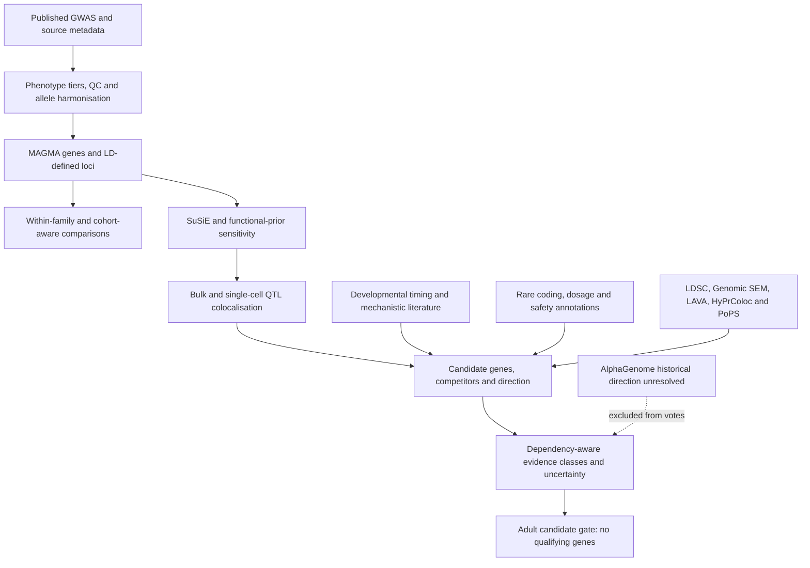

# Computational methodology

This is a hypothesis-generating programme linking human cognition associations to candidate biological mechanisms. It asks whether any defensible gene/mechanism retains adult relevance. It does not equate an associated allele, a predicted molecular effect or adult expression with a safe intervention.

The execution record progresses from foundational evidence atlases (Sprints 1–2), to the genome-wide gene tournament (3), corrective synaptic reconstruction (3.1), causal-synapse gates (4), gene adjudication (5), and open-data integration (5A). The last completed research snapshot is 24 September 2026. The public release adds a documented AlphaGenome exclusion and cached re-adjudication; it does not rerun the GWAS.

## Eight different evidentiary standards

1. **Genetic association:** an allele or gene statistic correlates with a measured phenotype, conditional on the study design.
2. **Statistical fine-mapping:** a model assigns variants posterior inclusion probabilities given association statistics, LD and priors.
3. **Candidate causal-gene attribution:** coding effects, regulatory links and molecular colocalisation implicate a gene, with competitors retained.
4. **Expression direction:** allele-aligned molecular effects suggest higher/lower expression for the cognition-increasing allele, only in the tested context.
5. **Mechanistic evidence:** biological studies support a pathway or causal arrow; species, cell state and perturbation context matter.
6. **Adult modifiability:** a mechanism remains active and changeable after development; expression alone cannot demonstrate this.
7. **Experimental validation:** controlled perturbations test the proposed mechanism and outcomes. This programme performed none.
8. **Demonstrated enhancement:** a reproducible improvement in human cognitive capability with an acceptable risk profile. This programme established none.

## Implemented stages and what they establish

Every execution claim in this table refers to historical committed outputs unless explicitly labelled release re-adjudication. Source populations, access terms and file acquisition are in [DATASETS.md](DATASETS.md) and its machine-readable manifest.

| Stage / question and rationale | Implementation, inputs and outputs | Assumptions, contribution and boundary |
|---|---|---|
| **Source ingestion and phenotype tiers:** which records measure cognition? | [classify_studies.py](pipelines/gene_tournament/classify_studies.py), [study metadata](data/gene_tournament/study_metadata.jsonl), [phenotype channels](atlases/gene_tournament/phenotype_channels.yaml) | Strict cognition, MTAG, clinical/ageing, education/proxy channels are separate. Broad discovery metadata is not proof that full data were analysed. Cohort labels can be incomplete. |
| **GWAS QC and harmonisation:** are effect alleles comparable? | [loci_tools.py](pipelines/sprint4/loci_tools.py), [within-family VCF parser](pipelines/sprint4/gate_a_within_family.py), [locus integration](pipelines/sprint5/locus_confidence.py) | Checks study identity/build, REF/ALT, strand, ambiguous palindromes and proxies. Trail-making time is inverted because higher time is worse. Unresolved alignments are excluded, never assigned a sign. Assumes summary metadata and reference alleles are correct. |
| **MAGMA gene statistics:** which genes aggregate SNP association? | [ingestion/reverification](pipelines/gene_tournament/ingest_magma_gene_analysis.py), [raw MAGMA outputs](data/raw/magma_x01/2026-09-22), [18,418-gene table](reports/gene_tournament/direct_cognition_rank.csv) | Gene windows and LD induce correlations. Historical external MAGMA outputs were checked against the raw Davies public subset; deterministic fields were distinguished from permutation noise. This release checks tables, not that original genome-wide rerun. |
| **LD-aware loci:** how many association units? | [LD summary](data/gene_tournament/ld_loci_summary.json), [LD blocks](data/gene_tournament/ld_loci.parquet) | Connected components of gene-statistic correlations, primary threshold 0.2, reduce 375 significant genes to 159 blocks. Chained correlations can over-merge blocks. These are neither 159 proven causal genes nor independent participants. |
| **Competitive gene sets and multiple testing:** which functions exceed the gene background? | [run_pathway_enrichment.py](pipelines/gene_tournament/run_pathway_enrichment.py), [corrective reconstruction](pipelines/sprint3_1/run_recon_magma.py), [pathway results](reports/gene_tournament/pathway_enrichment.csv) | Controls include gene size/density, LD, annotation density, LoF constraint and neuronal expression as specified. Bonferroni gene tests and global FDR set tests address multiplicity; nominal sensitivity results stay labelled. GO propagation and missing-gene universe defects were corrected. Broad synaptic/developmental enrichment remains, not uniquely presynaptic biology. |
| **Within-family Gate A:** do directions survive a family design? | [gate_a_within_family.py](pipelines/sprint4/gate_a_within_family.py), Howe VCF provenance, [159-locus output](reports/sprint4/within_family_locus_concordance.csv), [updated gate](reports/sprint4/decision_gate_a_update.json) | Family estimates reduce stratification/indirect-effect bias but are noisy and share cohorts with discovery. 109/146 concordance supports an aggregate pattern, not each locus. SE-derived effective N differs from metadata N. Seeded LD-aware calibration is inherited, not rerun for release. |
| **G&C and other comparisons:** is support independent? | [gate_b_genc.py](pipelines/sprint4/gate_b_genc.py), [overlap ledger](data/sprint5/cohort_overlap_ledger.csv), [locus confidence](data/release/locus_confidence.csv) | G&C recruitment is UKB-free; participant overlap remains unverified. GenLang shares BATS and Zabaneh shares HRS, so they are sensitivity evidence. In 5A, G&C and within-family designs are counted lineages by frozen rule, not disjoint samples. |
| **Locus uncertainty and shrinkage:** how robust is support? | [locus_confidence.py](pipelines/sprint5/locus_confidence.py), [frozen rules](research/sprint5/protocol_rules.json), [152-signal table](data/release/locus_confidence.csv) | Unique lead SNPs collapse 159 blocks to 152 signals. Stable EB shrinkage replaced defective KDE-Tweedie tail behaviour after initial outcomes were seen. Bayes factors/strata and bootstrap rank intervals are model-dependent, not calibrated causal probabilities. |
| **SuSiE:** which variants could explain a signal? | [gate_c_coloc.py](pipelines/sprint4/gate_c_coloc.py), [fine-mapping assembly](pipelines/sprint5a/assemble_finemapping.py) | Summary LD, allele/build alignment and finite causal components determine credible sets. Historical 36 loci were analysed; 28 had usable GWAS credible sets for multi-signal coloc. Variant PIP is not gene or intervention probability. |
| **PolyFun + SuSiE sensitivity:** does functional information sharpen sets? | [Python preparation](pipelines/sprint5a/polyfun_susie.py), [R execution](pipelines/sprint5a/polyfun_susie.R), [summary](reports/sprint5a/functional_finemapping_summary.csv) | Published priors produced five PIP>0.5 variants only under the prior. Such variants are labelled prior-dependent and not promoted to primary coding evidence. SLC39A8 A391T is robust without that prior. |
| **coloc.abf / coloc.susie:** do trait and expression share a signal? | [bulk implementation](pipelines/sprint4/gate_c_coloc.py), [single-cell implementation](pipelines/sprint5a/sc_eqtl_coloc.py), [sc-eQTL results](reports/sprint5a/sc_eqtl_coloc.parquet) | ABF uses a single-causal-variant approximation; SuSiE addresses multiple signals conditional on LD. PP.H4>=0.8 defines strong rows under the protocol. Historical single-cell execution: 4,700 ABF + 919 SuSiE tests, 141 strong rows / 42 locus–gene pairs. Rows sharing donors or signals are not independent experiments; colocalisation is not mediation. |
| **FOCUS / joint gene–tissue fine-mapping:** are QTL genes passengers? | [run_focus_loci.py](pipelines/sprint4/joint_gene_tissue/run_focus_loci.py), [gene–tissue output](reports/sprint4/joint_gene_tissue_finemapping.csv) | Uses externally obtained prediction weights/reference inputs and model assumptions. Primary/sensitivity configurations can favour different genes. FOCUS acts as a contradiction check, not another independent vote. |
| **brainSCOPE tagging and regulatory evidence:** which cells and signals? | [typed evidence](pipelines/sprint5a/brainscope_typed_evidence.py), [output](reports/sprint5a/brainscope_typed_evidence.parquet), [testability audit](reports/sprint5a/brainscope_coloc_testability.json) | Public significant-only/conditional outputs cannot support unbiased full colocalisation. GRN links and promoter proximity are not automatically ENHANCER_LINK evidence. EXOC4/NEGR1 tagging can be a different signal; SH2B1 shares ROSMAP donors. |
| **Adult vs developmental context:** when might mechanisms act? | [expression classification](pipelines/gene_tournament/build_developmental_classification.py), [developmental timing](pipelines/sprint5a/devbrain_timing.py), [regulatory timing](reports/sprint5a/regulatory_timing.csv), [GTEx lookup](pipelines/sprint5a/gtex_v11_lookup.py) | GTEx TPM and BrainSpan RPKM are not combined numerically. BrainSpan age-window means weight samples, not donors; its adult window contains 93 samples from six donors. DevBrain fetal colocalisation adds timing, not adult perturbation proof. GTEx V11 uses the same donor lineage as V10. |
| **AlphaGenome:** can sequence models add regulatory context? | [query](pipelines/sprint5/alphagenome_query.py), [summarisation](pipelines/sprint5a/alphagenome_summarise.py), [correction](docs/corrections/ALPHAGENOME_DIRECTION.md) | Historical Atlas predictions were run. Sign aggregation was defective; raw predictions are not in Git. The code fix is tested, but directions and QTL agreement are unresolved and excluded from release evidence. Model predictions do not validate biology. |
| **LDSC:** how much genome-wide genetic sharing? | [input preparation](pipelines/sprint5a/prep_ldsc_inputs.py), [h2](reports/sprint5a/ldsc_h2_core5.csv), [rg](reports/sprint5a/ldsc_rg_core5.csv) | Requires appropriate LD scores, harmonisation and well-behaved association statistics. Cross-trait intercepts account imperfectly for overlap/confounding. Reported correlations with g ~0.68–0.87 do not identify a gene or causal direction. |
| **Genomic SEM:** common versus phenotype-specific covariance? | [R analysis](pipelines/sprint5a/genomicsem_lava.R), [factor fit](reports/sprint5a/genomicsem_commonfactor_fit_core5.csv), [factor components](reports/sprint5a/genomicsem_commonfactor_core5.csv) | Fits the LDSC covariance/sampling structure; historical CFI ~0.99, arithmetic residual ~0.37, PIQ ~0.45. Good fit does not prove a unique biological factor. A factor GWAS was evaluated but not run. |
| **LAVA:** where is cross-trait sharing local? | Same [R analysis](pipelines/sprint5a/genomicsem_lava.R), [bivariate results](reports/sprint5a/lava_bivariate_core5.csv) | Local heritability/testability and LD/overlap correction matter; Bonferroni over performed bivariate tests. EXT1↔EF, DPP4↔PIQ and KCNJ3↔arithmetic are locus labels, not established shared genes. |
| **HyPrColoc:** do several traits/QTLs cluster? | [Python](pipelines/sprint5a/multitrait_coloc.py), [R](pipelines/sprint5a/multitrait_coloc.R), [results](reports/sprint5a/multitrait_coloc.csv) | Approximate shared-variant clustering depends on priors/causal architecture. Overlapping samples make these descriptive; no GWAS-only clusters were established. QTL clusters are not independent replication. |
| **PoPS LOCO:** do gene features support alternatives? | [preparation](pipelines/sprint5a/pops_prep.py), [runner](pipelines/sprint5a/run_pops.sh), [scores](reports/sprint5a/pops_scores.csv) | Training excludes the scored chromosome. Features can prioritise SRF over DNPH1/TTBK1 or SLC4A10 over DPP4. It is never a V2G evidence vote; single-gene loci lack meaningful within-locus comparisons. |
| **Rare coding / CNV convergence:** do human perturbations agree? | [rare-coding integration](pipelines/sprint5/build_rare_coding_tables.py), [burden evidence](reports/sprint5/rare_coding_evidence.csv), [null tests](reports/sprint5/common_rare_convergence.csv) | UKB overlap, small carrier counts and multiple testing limit evidence. Rare loss of function is not a gain-of-function enhancement experiment. Positive-dosage claims remain nominal/unreplicated; convergence nulls are underpowered. |
| **Evidence graph, uncertainty and red team:** what can actually count? | [graph builder](pipelines/sprint5/build_evidence_graph.py), [classifier](pipelines/sprint5/classify_genes.py), [foundational ranking](models/ranking/rank_targets.py), [truth table](reports/project_truth_table.md) | Sources sharing cohorts/signals/classes collapse. Nearest gene, L2G and PoPS do not become extra votes. Competing genes, FOCUS contradictions, sensitivity ranks and negative evidence remain explicit. Foundational atlas priorities are historical hypotheses, not final genes. |
| **Decision/stopping rules and release correction** | [decision implementation](pipelines/sprint5/decide_sprint5.py), [5A rules](research/sprint5a/protocol_rules.json), [release rebuild](scripts/release/rebuild_assessments.py), [current decision](data/release/decision.json) | Adult criteria require locus support, credible gene, adult molecular evidence and D1 together, followed by biological/safety/tractability checks. Safety is never auto-cleared. No gene qualifies. Cached re-adjudication excludes three AlphaGenome units and leaves these conclusions unchanged. |

## What was considered but not completed

TGFM required controlled GTEx genotype access; cTWAS remained scheduled because of compute/input burden; non-European fine-mapping lacked a sufficiently powered source; SAIGE-GENE+/STAAR burden testing required individual-level sequence data. Full brainSCOPE colocalisation, 23andMe Gq fine-mapping and larger family-GWAS follow-up remained access-blocked. These are not completed results. [Historical access queue](reports/sprint5a/USER_ACCESS_REQUIRED.md).

## Execution, provenance and reproducibility

The frozen rules and original decision logs remain under `research/`, `data/` and `reports/`. [Source manifest](data/release/source_manifest.json), [raw acquisition spine](data/raw/MANIFEST.jsonl) and [release transformation ledger](docs/security/sanitisation_manifest.json) distinguish downloaded bytes from privacy-minimised release copies. Historical machine paths are not prerequisites: external data now have documented local placement/overrides.

The [reproduction guide](REPRODUCIBILITY.md) defines three levels: inspect committed results; rebuild cached classifications; reacquire/run upstream scientific analyses. Only the first two were exercised for this release. External study publications and service licences are cited in the dataset guide; historical literature interpretation remains subject to expert review.
